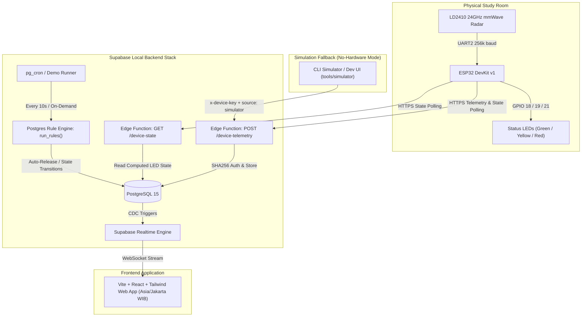

# RoomPulse — Sensor-Verified Study Room Booking System

> **STACK 2026 Semifinal Prototype**  
> Physical mmWave radar verification preventing ghost bookings in university study rooms and focus pods.

---

## 1. Product Summary & Architecture

University study rooms are frequently booked but physically empty ("ghost bookings"), leaving students who need a workspace locked out. RoomPulse pairs an ESP32 microcontroller with an **HLK-LD2410 mmWave presence sensor** and a 3-state door LED. When a booking start time arrives and the room remains physically unoccupied, the system prompts the booker to confirm their arrival. If the confirmation deadline passes without physical arrival or response, the room is automatically released, the door LED turns green, and campus students can claim the room.

**Privacy-First Guarantee**: No cameras, no microphones, and no identity tracking from sensors. The sensor records only binary presence, distance, and motion/static energy levels.

### Architecture Diagram



---

## 2. Honesty Disclosure (Mandatory Hackathon Rules)

In strict adherence to rule §2:
- **Implemented & Functional**:
  - Full PostgreSQL schema with conditional exclusion constraints (`tstzrange` via `btree_gist`) preventing double bookings.
  - Idempotent `run_rules()` rule engine with row-level locks (`SELECT ... FOR UPDATE SKIP LOCKED`).
  - Safety lock: **Zero auto-releases when sensor is offline** (`skipped_sensor_offline` logged).
  - ESP32 firmware with PlatformIO (`ncmreynolds/ld2410`), dual UART communication, and automatic offline visual fail-safe (slow yellow blink).
  - Mobile-first React dashboard with Supabase Realtime synchronization and Asia/Jakarta timezone.
  - Complete CLI simulator tool (`empty`, `present`, `present-then-leave`, `flaky`, `offline`) and automated scenario runner.
- **Simulated in Development**:
  - Without physical hardware connected, sensor readings are produced by `tools/simulator` with API key `sim_key_default_dev`.
  - Every simulated reading stores `source = 'simulator'` in `sensor_readings`.
  - The Web UI visibly highlights **`[SIMULATED SENSOR DATA]`** in amber on room cards and details.
- **Documented as Future Work (P2 Scope)**:
  - External Telegram bot automated message push (table `profiles.telegram_chat_id` exists for schema readiness).
  - Physical multi-zone beam-forming radar for ultra-wide auditorium rooms.

---

## 3. Quick Start & Setup

### Prerequisites
- Node.js v20+ and npm
- Docker Desktop (running)
- Python 3.10+
- Supabase CLI

### One-Command Setup

1. **Clone and enter repository**:
   ```bash
   git clone https://github.com/your-org/roompulse.git
   cd roompulse
   ```

2. **Configure Environment**:
   ```bash
   cp .env.example .env.local
   ```

3. **Start Local Supabase & Apply Migrations/Seed**:
   ```bash
   npm run start:supabase
   ```

4. **Run Rule Engine Tests**:
   ```bash
   npm run test:sql
   ```

5. **Start Web Frontend**:
   ```bash
   npm run dev
   ```
   Open `http://localhost:5173` in your browser.

---

## 4. Demo Accounts

| Role | Email | Password | Display Name |
| :--- | :--- | :--- | :--- |
| **Student** | `student1@roompulse.local` | `password123` | Alice Pratama |
| **Student** | `student2@roompulse.local` | `password123` | Bob Santoso |
| **Staff** | `staff@roompulse.local` | `password123` | Library Staff Lead |

*Note: The login page provides 1-click login buttons for instant demo switching.*

---

## 5. Physical Wiring & Firmware (ESP32 + LD2410)

See [docs/HARDWARE_TEST_CHECKLIST.md](file:///d:/porto/lomba/docs/HARDWARE_TEST_CHECKLIST.md) for full schematic and resistor requirements.

To compile firmware:
```bash
npm run build:firmware
```
To flash to a connected ESP32:
```bash
python -m platformio run -d firmware --target upload
```
